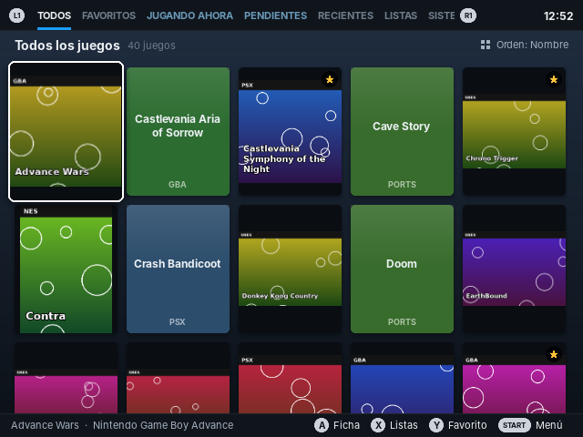
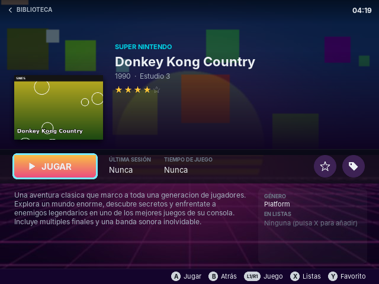
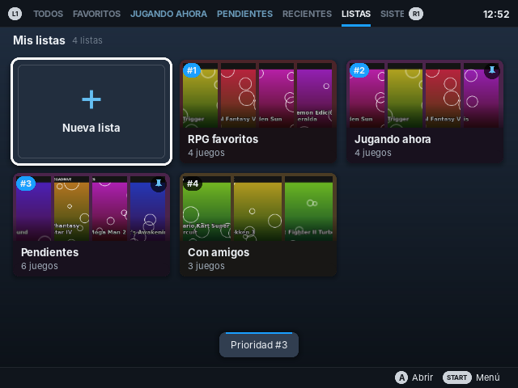
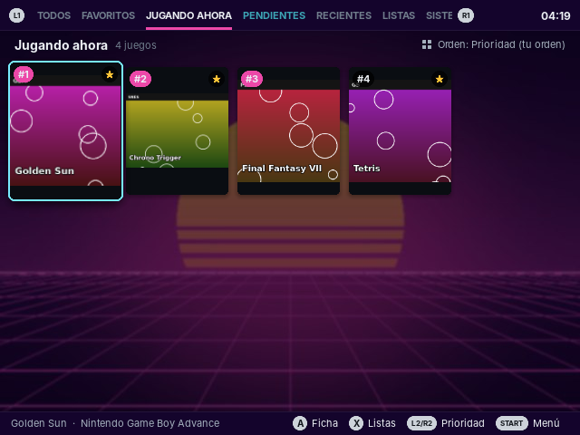
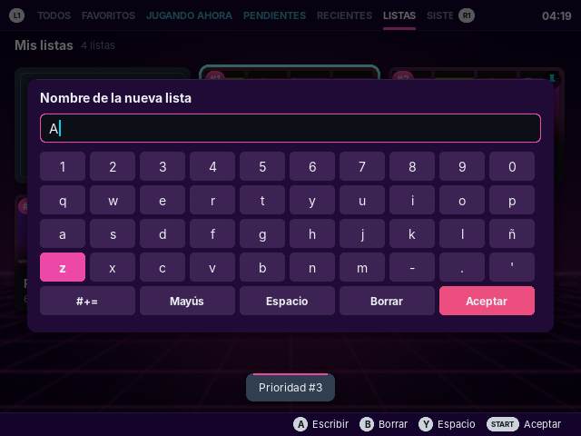

# Vapor: biblioteca estilo Steam para ArkOS (R36S)

**Vapor** es un mod para la **R36S** (y otras consolas con **ArkOS**) que añade una forma de ver tus juegos
parecida a la biblioteca de **Steam**: carátulas grandes, ficha de cada juego con botón **JUGAR**,
pestañas, favoritos, tiempo de juego y **listas propias ordenadas por prioridad**.

No sustituye a EmulationStation: es un “port” más que se abre desde **Ports**, usa **las mismas ROMs,
imágenes y emuladores** que ya tienes y, al salir, vuelves a EmulationStation como siempre.



| Ficha del juego | Listas con prioridad |
|---|---|
|  |  |
| **Una lista como pestaña (igual que Favoritos)** | **Ordenar las listas** |
|  |  |

> Las capturas usan carátulas de prueba generadas automáticamente; en tu consola verás las tuyas.

## Qué incluye

- **Biblioteca estilo Steam** en cuadrícula de carátulas, o vista de **detalles** (SELECT cambia entre ambas).
- **Pestañas**: Todos · Favoritos · *tus listas* · Recientes · Listas · Sistemas · Géneros. Se cambia con **L1/R1**.
- **Ficha de cada juego**: imagen de fondo, carátula, descripción, género, estrellas, botón verde **JUGAR**,
  última sesión y **tiempo de juego**.
- **Listas propias** (tus “categorías”): crea todas las que quieras, mete juegos con **X** y quedan guardadas.
- **Prioridad**:
  - de **las listas** (cuál es la #1, la #2…), y
  - de **los juegos dentro de cada lista y de Favoritos** (#1, #2, #3… en la esquina de la carátula).
- **Listas como pestaña**: cada lista puede aparecer arriba, junto a Favoritos, en su orden de prioridad.
- **Favoritos** (con **Y**). Importa automáticamente los favoritos que ya tenías en EmulationStation.
- **Búsqueda** con teclado en pantalla, **ordenar** por nombre, sistema, jugado recientemente,
  tiempo de juego o veces jugado.
- **Importa** tus colecciones personalizadas de EmulationStation y puede **exportar** tus listas a EmulationStation.
- Español e inglés.

## Requisitos

- R36S (o clon) con **ArkOS** (incluida la versión de ArkOS para R36S).
- Nada más: no hace falta internet ni instalar paquetes. Usa Python 3 y SDL2, que ya vienen en ArkOS.

## Instalación (desde el PC, sin comandos)

1. Descarga el paquete listo para copiar:
   **[dist/Vapor-R36S.zip](https://github.com/delasherasmd/R36S/raw/claude/r36s-steam-view-mod-mgribp/dist/Vapor-R36S.zip)**
   y descomprímelo. Dentro hay una carpeta **`ports`**, una carpeta `extra` y un `LEEME.txt`.
2. Saca la micro SD donde están **tus juegos** y ábrela en el PC. Es la partición que tiene las carpetas
   `gba`, `snes`, `psx`, `nes`… (normalmente se llama **EASYROMS**).
   - Si tu R36S usa **dos tarjetas**, los juegos suelen estar en la segunda (ranura izquierda / TF2).
     **Si no sabes cuál usa la consola, copia Vapor en las dos**: no pasa nada.
3. Copia la carpeta **`ports`** del ZIP en la **raíz** de esa partición, al lado de `gba`, `snes`…
   Si Windows pregunta si quieres combinar la carpeta `ports` que ya existe, di que **sí**.
   Tiene que quedar **exactamente** así:

   ```
   EASYROMS/
   ├── gba/  snes/  psx/ ...
   └── ports/
       ├── Vapor.sh          ← directamente aquí
       └── vapor/
           ├── main.py
           └── ...
   ```

   ⚠️ EmulationStation **no mira las subcarpetas** de `ports`: si queda como `ports/ports/Vapor.sh`
   o `ports/R36S-.../Vapor.sh`, no aparecerá.
4. Pon la tarjeta en la consola y enciéndela (si ya estaba encendida:
   **START → QUIT → RESTART EMULATIONSTATION**).
5. Entra en el sistema **Ports** y abre **Vapor**.

> Si copias por red/SSH (WinSCP, etc.), la carpeta es `/roms/ports/` (o `/roms2/ports/` si usas la segunda SD).

### Si Vapor no aparece en Ports

- **El sistema Ports no sale en el menú principal** → START → **UI SETTINGS → VISIBLE SYSTEMS** y activa
  **Ports**. Reinicia EmulationStation.
- **Ports sale pero Vapor no está en la lista** → tu EmulationStation está configurado para leer solo los juegos
  apuntados en `gamelist.xml`. Con una de estas dos opciones basta:
  1. En la consola: START → **ADVANCED SETTINGS → PARSE GAMESLISTS ONLY → OFF** y reinicia EmulationStation.
  2. En el PC: si **no** existe `ports/gamelist.xml`, copia ahí `extra/gamelist.xml` del ZIP.
     Si **ya** existe, ábrelo con el Bloc de notas y pega el contenido de `extra/entrada-gamelist.txt`
     justo **antes** de la última línea `</gameList>`.
- **Comprueba la carpeta**: `Vapor.sh` debe estar directamente en `ports/`, en la tarjeta/partición donde
  están tus juegos (o en las dos tarjetas si tienes dos).
- **Aparece pero se cierra enseguida** → abre `ports/vapor/data/vapor.out` con el Bloc de notas y mándame
  lo que diga.

## Controles

| Botón | Qué hace |
|---|---|
| **Cruceta / stick** | Moverse |
| **L1 / R1** | Cambiar de pestaña |
| **A** | Abrir la ficha del juego · en la ficha: **JUGAR** |
| **B** | Atrás (en la pantalla principal pregunta si quieres salir) |
| **X** | Añadir o quitar el juego de tus listas |
| **Y** | Marcar o desmarcar como favorito |
| **L2 / R2** | En una lista o en Favoritos: **subir / bajar la prioridad** del juego. En la pestaña LISTAS: subir / bajar la prioridad de la lista. En el resto: saltar por letra |
| **SELECT** | Cambiar vista cuadrícula / detalles |
| **START** | Menú (buscar, ordenar, nueva lista, ordenar listas, exportar…) |
| **SELECT + START** | Salir de Vapor y volver a EmulationStation |

Los botones se leen de la configuración de EmulationStation (`es_input.cfg`), así que coinciden con los de tu consola.
Si en EmulationStation activaste **SWITCH A/B BUTTONS**, Vapor también los intercambia.

## Listas y prioridades

### Crear una lista
- Pestaña **LISTAS → Nueva lista**, o
- Pulsa **X** sobre cualquier juego → **Nueva lista…** (el juego se añade directamente).

Escribe el nombre con el teclado en pantalla: **A** escribe, **B** borra, **Y** espacio, **START** acepta.

### Añadir o quitar juegos
Pulsa **X** sobre un juego (en la cuadrícula o en su ficha) y marca/desmarca las listas que quieras.
Un juego puede estar en varias listas a la vez.

### Ordenar los juegos de una lista (y Favoritos) por prioridad
Dentro de una lista (o en Favoritos) cada carátula muestra su número **#1, #2, #3…**
- **L2 / R2** sube o baja el juego seleccionado una posición, o
- **START → Ordenar juegos de «lista»…**: con **A** coges un juego, con **↑ ↓** lo mueves y con **A** lo sueltas, o
- **START → Poner este juego el #1**.

### Ordenar las listas por prioridad
En la pestaña **LISTAS** cada lista muestra su número (#1 es la más importante):
- **L2 / R2** sobre una lista la sube o la baja, o
- **START → Ordenar listas por prioridad…** (A coger · ↑↓ mover · A soltar), o
- **X** sobre la lista → **Prioridad máxima (#1) / Subir prioridad / Bajar prioridad**.

### Listas como pestaña (igual que Favoritos)
Las listas nuevas aparecen arriba, al lado de **FAVORITOS**, siguiendo su orden de prioridad.
Para quitar o poner una lista en la barra de pestañas: **X** sobre la lista → **Mostrar como pestaña: sí/no**.

### Dónde se guardan
Todo se guarda **al instante** en la propia tarjeta, junto a tus juegos:

```
EASYROMS/ports/vapor/data/library.json      ← tus listas, su orden, favoritos y ajustes
EASYROMS/ports/vapor/data/library.json.bak  ← copia de seguridad automática
EASYROMS/ports/vapor/data/history.log       ← tiempo de juego
```

- Para hacer una copia de seguridad basta con copiar la carpeta `data` al PC.
- Si un día pasas las ROMs de la SD1 a la SD2 (de `/roms` a `/roms2`), Vapor recoloca las listas solas.
- Si el archivo se estropea (por ejemplo, por un apagón), Vapor recupera la copia `.bak`.
- **Exportar a EmulationStation** (menú START) guarda cada lista como “colección personalizada” de
  EmulationStation. Después reinicia ES y actívalas en *START → Game Collection Settings → Custom Game Collections*.

## Cómo lanza los juegos

Vapor lee `es_systems.cfg`, `es_settings.cfg` y los `gamelist.xml` igual que EmulationStation y construye
**exactamente el mismo comando** que usaría EmulationStation (incluido el emulador/core elegido para cada juego o
sistema y el gobernador de CPU). Al cerrar el juego vuelves a Vapor, a la misma ficha donde estabas,
y se suma el tiempo jugado.

## Solución de problemas

- **No aparece Vapor en Ports**: mira la sección [Si Vapor no aparece en Ports](#si-vapor-no-aparece-en-ports).
- **Se abre y vuelve enseguida a EmulationStation**: mira `ports/vapor/data/vapor.out` y `vapor.log`
  (se pueden abrir con el Bloc de notas en el PC).
- **No salen carátulas**: Vapor usa las imágenes de tus `gamelist.xml`. Si tus juegos no tienen imágenes,
  usa el *scraper* de EmulationStation (o Skraper en el PC). También detecta carpetas `images/`, `media/`,
  `boxart/`, `snap/`…
- **Un juego no arranca desde Vapor**: prueba a abrirlo desde EmulationStation; Vapor usa el mismo comando.
- **Desinstalar**: borra `ports/Vapor.sh` y la carpeta `ports/vapor`. No toca nada más del sistema.

## Para desarrolladores

```
ports/Vapor.sh          lanzador (bucle: Vapor → juego → Vapor, y apunta el tiempo de juego)
ports/vapor/main.py     arranque
ports/vapor/sdl.py      bindings ctypes de SDL2 / SDL2_ttf / SDL2_image (sin compilar nada)
ports/vapor/library.py  lectura de la configuración de EmulationStation y comando de lanzamiento
ports/vapor/store.py    listas, prioridades, favoritos, historial
ports/vapor/views.py    pantallas (biblioteca, listas, ficha)
ports/vapor/dialogs.py  menú, casillas, teclado en pantalla, ordenar por prioridad
tools/                  generador de iconos, paquete ZIP (make_dist.py), ArkOS de prueba y capturas
dist/Vapor-R36S.zip     paquete listo para copiar a la tarjeta
tests/                  pruebas automáticas
```

Probar en un PC con Linux (necesita `libsdl2-2.0-0`, `libsdl2-ttf-2.0-0`, `libsdl2-image-2.0-0`; Pillow solo
para las herramientas):

```sh
python3 tools/make_fake_arkos.py /tmp/fakeark
python3 ports/vapor/main.py --window 640x480 --home /tmp/fakeark/home \
        --es-dir /tmp/fakeark/etc --data /tmp/fakeark/data
python3 -m unittest discover -s tests
```

En el PC: flechas = cruceta, Enter = A, Esc = B, C = X, V = Y, Q/E = L1/R1, Inicio/Fin = L2/R2,
S = START, Tab = SELECT.

Compatible con Python 3.6 o superior (ArkOS trae 3.7+).

## Licencias

La fuente incluida es **Inter** (© The Inter Project Authors), con licencia SIL Open Font License 1.1:
ver `ports/vapor/assets/fonts/OFL.txt`. “Steam” es una marca de Valve; este proyecto no está relacionado con Valve.
